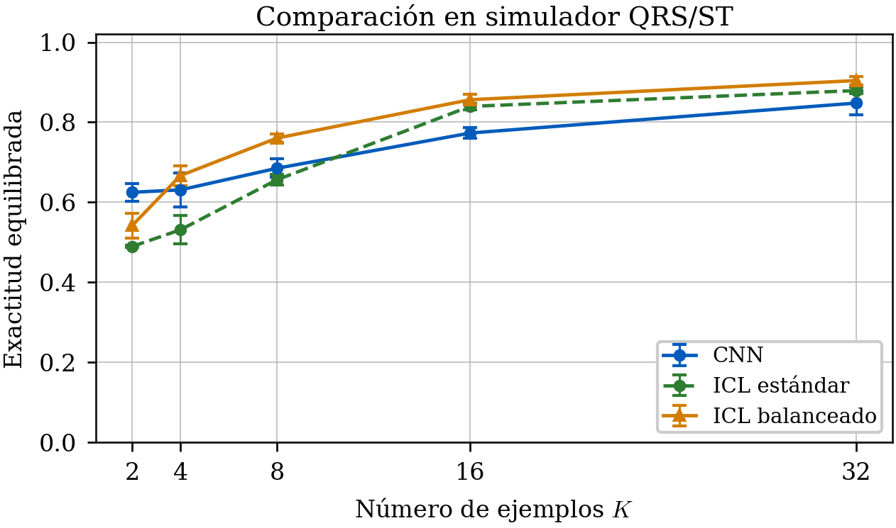
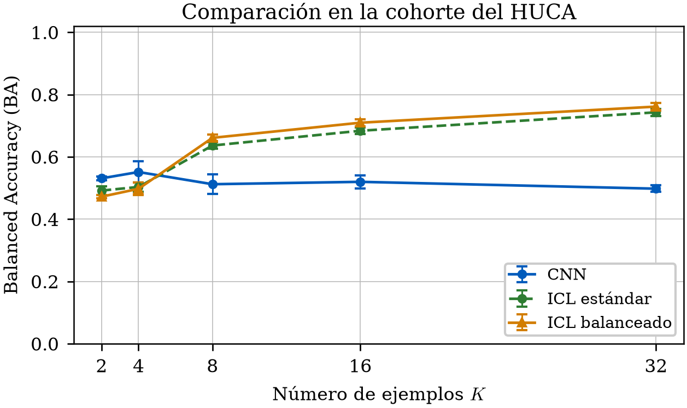

# ECG como imagen para Brugada con pocos ejemplos

Este repositorio contiene el código y la memoria de un estudio sobre clasificación de ECG representados como imagen. Se comparan dos usos de un conjunto pequeño de ejemplos:

- una CNN ResNet18 que actualiza sus pesos
- Gemma 4 E4B como modelo de visión y lenguaje con aprendizaje en contexto

El trabajo es experimental. No proporciona diagnóstico, no descarta enfermedad y no sustituye la revisión especializada.

## Diseño y datos

Los dos enfoques se evalúan por paciente con `K = 2, 4, 8, 16, 32` y las semillas `42, 123, 2026`. El VLM añade una condición zero-shot con `K = 0`.

| Conjunto | Pacientes | Imágenes únicas | Positivos | Negativos | Referencia |
|---|---:|---:|---:|---:|---|
| Simulador QRS/ST | 100 | 100 | 20 | 80 | Regla morfológica |
| Subconjunto HUCA procesado | 317 | 317 | 116 | 201 | `clinical_brugada` de la campaña |

Las matrices agregadas contienen 300 y 951 predicciones, respectivamente, porque suman tres semillas sobre los mismos pacientes. Esos valores no son tamaños de muestra ni números de imágenes únicas.

La CNN aprende RBBB, elevación ST e inversión de T en el simulador. La cohorte real no contiene esas tres anotaciones por imagen, por lo que la evaluación real de la CNN mide transferencia hacia una referencia clínica. Gemma 4 se evalúa con contexto estándar, contexto balanceado y sin demostraciones.

## Resultados finales

### Dominio sintético

| Método | K | BA, media y DE | F1 | Sens. | Esp. |
|---|---:|---:|---:|---:|---:|
| CNN ResNet18 | 32 | 0.885 ± 0.013 | 0.771 | 0.867 | 0.904 |
| Gemma 4 zero-shot | 0 | 0.500 ± 0.000 | 0.000 | 0.000 | 1.000 |
| Gemma 4 ICL estándar | 32 | 0.879 ± 0.008 | 0.781 | 0.833 | 0.925 |
| Gemma 4 ICL balanceado | 32 | 0.904 ± 0.011 | 0.825 | 0.867 | 0.942 |



### Transferencia sintético-real

La CNN base alcanza su mejor punto real en `K=4`, con BA `0.551 ± 0.034`. MMD mejora la base de `K=32` desde `0.498` hasta `0.546`, pero no supera el mejor resultado global de la CNN.

Gemma 4 con demostraciones sintéticas permanece cerca del azar. El mejor punto balanceado aparece en `K=16`, con BA `0.514 ± 0.008`, sensibilidad `0.063` y especificidad `0.965`.

### Contexto clínico

| Método | K | BA, media y DE | F1 | Sens. | Esp. |
|---|---:|---:|---:|---:|---:|
| CNN ResNet18 base | 4 | 0.551 ± 0.034 | 0.506 | 0.670 | 0.433 |
| Gemma 4 zero-shot | 0 | 0.499 ± 0.001 | 0.000 | 0.000 | 0.998 |
| Gemma 4 ICL estándar | 32 | 0.743 ± 0.011 | 0.675 | 0.690 | 0.796 |
| Gemma 4 ICL balanceado | 32 | 0.761 ± 0.011 | 0.699 | 0.741 | 0.781 |



El contexto clínico mejora el VLM en esta cohorte, pero el resultado no incluye validación externa ni pruebas inferenciales planificadas. No justifica un uso asistencial.

## Organización

```text
src/ecg_few/                    Código Python principal
scripts/eval/                   Evaluación y comparaciones
scripts/run/                    Entradas reproducibles
scripts/thesis/                 Figuras y auditoría de la memoria
prompts/                        Prompts VLM
reports/loocv/                  Resultados agregados para regenerar las gráficas
thesis/thesis/                  Fuente LaTeX
thesis/thesis/assets/results/   Figuras versionadas
```

Se versionan los resúmenes agregados por valor de `K`, condición y método que consumen los renderizadores del TFG. No se incluyen predicciones por paciente, pliegues LOOCV, imágenes, manifiestos clínicos ni rutas a datos en crudo. El contenido y los criterios de inclusión se documentan en `reports/loocv/README.md`.

La fuente LaTeX, los logos y todas las figuras utilizadas por la memoria también se versionan. Los datos clínicos del HUCA y los resultados LOOCV a nivel de paciente no son necesarios para compilar el PDF ni para regenerar sus gráficas, y se excluyen por privacidad y tamaño.

## Reproducción

Instalación:

```bash
uv sync --extra dev --extra cnn
```

Regeneración de las figuras finales con los resultados agregados incluidos en el repositorio:

```bash
RUN_COMPARISONS=0 sh scripts/run/build_tfg_report_figures.sh
```

Auditoría de cifras, unidades, figuras y uso de Draw.io:

```bash
uv run --no-sync python scripts/thesis/audit_final_tfg.py
```

### Compilación de la memoria

Tectonic descarga automáticamente los paquetes LaTeX requeridos y compila el proyecto con un motor compatible con XeTeX:

```bash
cd thesis/thesis
tectonic main.tex --reruns 2
```

Con una instalación completa de TeX Live también puede utilizarse XeLaTeX:

```bash
cd thesis/thesis
xelatex main.tex
xelatex main.tex
```

El resultado se genera en `thesis/thesis/main.pdf`. La plantilla usa Times New Roman cuando la fuente está instalada y recurre a TeX Gyre Termes en caso contrario.

Ejecuciones principales:

```bash
scripts/run/build_simulator_qrs_dataset.sh
scripts/run/build_brugada_huca_dataset.sh
scripts/run/run_cnn_simulator_qrs_loocv.sh
scripts/run/run_cnn_loocv.sh
scripts/run/run_all_vlm_experiments.sh
```

Validación del código:

```bash
uv run --no-sync pytest -q
uv run --no-sync ruff check .
uv run --no-sync python -m compileall -q src scripts
```

## Limitaciones

La cohorte real procede de un único origen y su referencia no equivale a las etiquetas morfológicas sintéticas. La distribución 116/201 guardada en la campaña final tampoco coincide con la composición 76/287 documentada para la versión pública de Brugada-HUCA. El paquete de resultados no contiene el manifiesto intermedio que explica esa transformación, por lo que debe conservarse antes de intentar reproducir la campaña. Las tres semillas repiten la evaluación sobre los mismos pacientes y su desviación estándar no representa incertidumbre poblacional.
