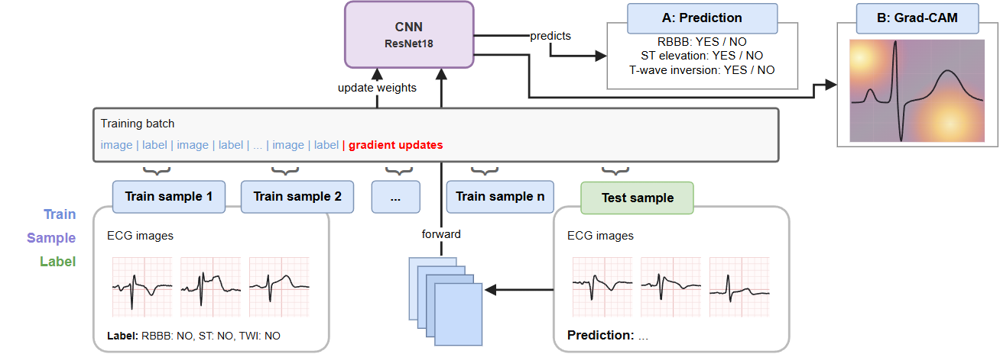
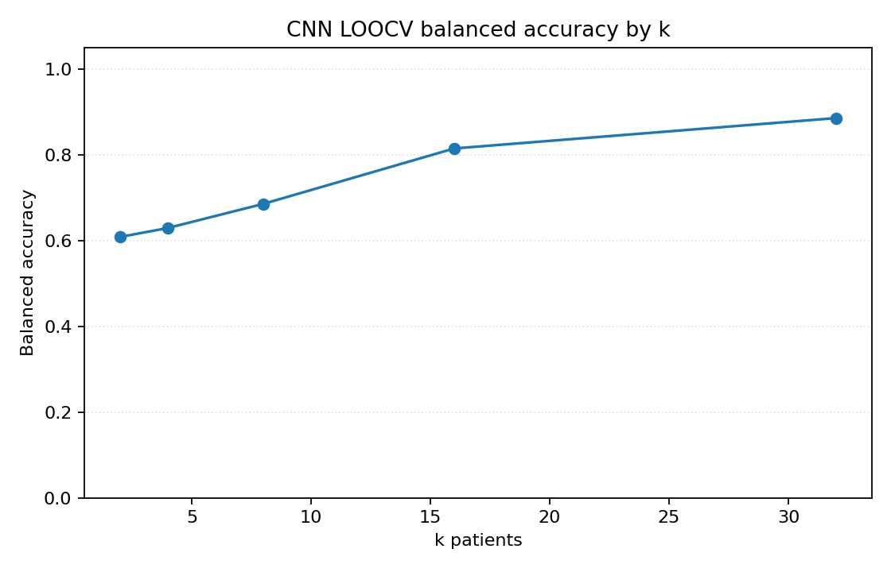
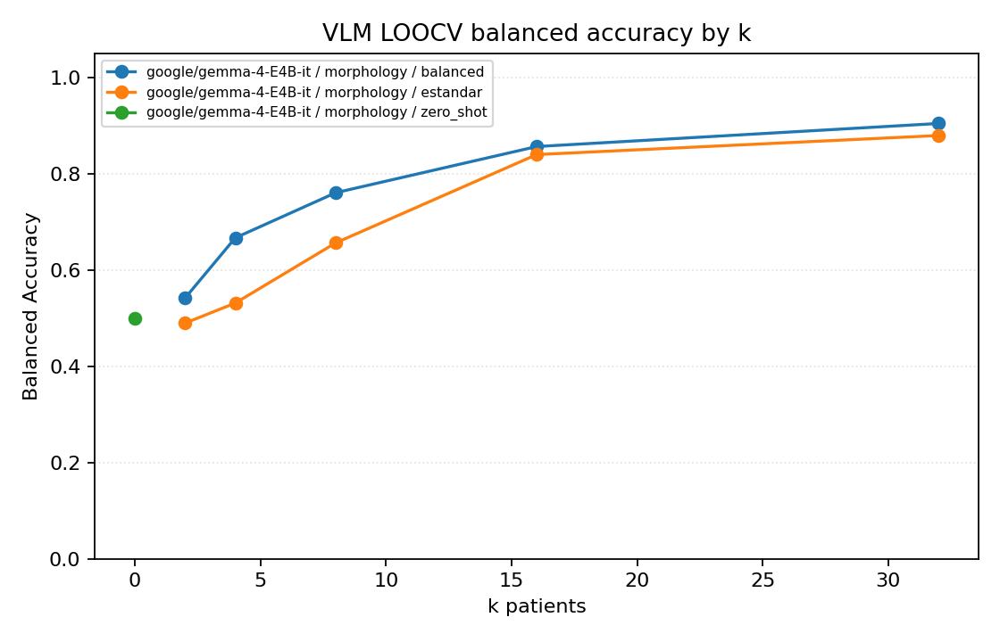
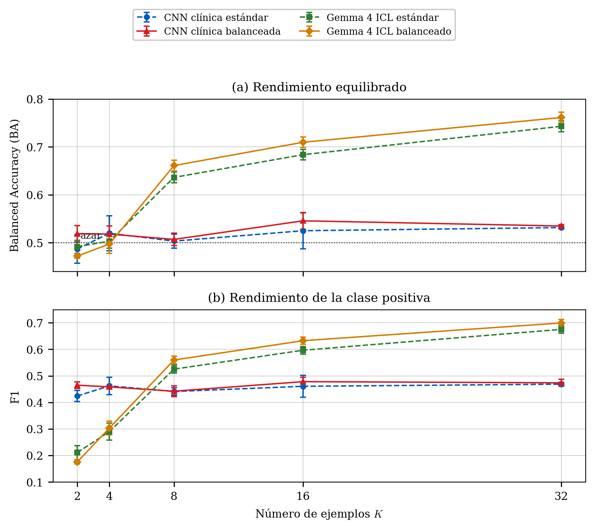

# ECG Few-Shot Learning

How far can a small number of examples take ECG image classification? This project compares a trained **ResNet18 CNN** with **vision-language in-context learning** on synthetic ECG morphology and the binary clinical reference in Brugada-HUCA.

The experiment code, presets, tests, and selected figures live here. The thesis, datasets, model weights, and full experiment outputs stay local. This is research software; the experiments do not establish diagnostic validity.

[Results](#results) · [Run experiments](#run-experiments) · [Code map](#code-map) · [Protocols](docs/experiments.md) · [Figure provenance](docs/results.md)

## Experimental workflow


The diagram gives the overall workflow; its embedded examples illustrate the procedure. The reported aggregate results are in the results section below.

Every test fold holds out a whole patient. The CNN trains on K examples and uses a separate validation set. The VLM receives K labelled demonstrations in its context window, with no weight updates. Both exclude the held-out patient from training or context.

| Experiment | Input and target | What changes with K |
| --- | --- | --- |
| Synthetic morphology | Generated ECG images; RBBB, ST elevation, and T-wave inversion, followed by a shared Brugada rule | CNN training examples or VLM demonstrations |
| Synthetic-to-real transfer | Synthetic support/training images, evaluated on HUCA | Support size and optional domain adaptation |
| Clinical classification | Real V1 images and the dataset's binary clinical reference | Clinical CNN training examples or real VLM demonstrations |

### Synthetic ECG generation

The simulator builds ECG waveforms from Gaussian components and varies morphology before rendering images. It supplies reproducible training data without distributing clinical records.


### CNN and in-context learning

The morphological CNN predicts three findings before applying the decision rule. The clinical CNN learns the binary reference directly. Grad-CAM is available for inspecting CNN predictions locally.



The VLM sees an instruction, labelled support images, and an unlabelled test image. The experiments compare zero-shot, standard selection (`estandar` in the CLI), and class-balanced selection (`balanced`).


Editable [draw.io sources](docs/assets/diagrams/) accompany the exported diagrams.

## Results

These are selected results from the preserved final campaign, using **K = 32** and mean ± standard deviation across three seeds. The synthetic and clinical tasks have different targets and must be interpreted separately.

<!-- final-results-table -->
| Task | Method | Balanced accuracy (%) | F1 (%) |
| --- | --- | --- | --- |
| Synthetic morphology | ResNet18 CNN | 88.54 ± 1.28 | 77.08 ± 2.26 |
| Synthetic morphology | Gemma, balanced | 90.42 ± 1.06 | 82.53 ± 1.16 |
| HUCA clinical reference | ResNet18 CNN, standard | 53.15 ± 0.24 | 46.86 ± 0.68 |
| HUCA clinical reference | ResNet18 CNN, balanced | 53.48 ± 0.28 | 47.38 ± 1.29 |
| HUCA clinical reference | Gemma, balanced real context | 76.12 ± 1.11 | 69.92 ± 1.33 |
<!-- /final-results-table -->

On synthetic morphology, both approaches improve with larger support sets. On the preserved clinical cohort, Gemma with real, balanced context performs better than the clinical CNN in these experiments. This does not establish external clinical generalization. Seed variation describes repeated runs on the same cohort, rather than population uncertainty.

| CNN on synthetic morphology | VLM on synthetic morphology |
| --- | --- |
|  |  |



The CNN uses validation examples in addition to its K training examples; the VLM uses K demonstrations without validation fitting. See [exact numerical sources, selection rules, and figure hashes](docs/results.md). No new experiments were run to create this summary.

## Run experiments

Run commands from the repository root with **Python 3.12+** and [uv](https://docs.astral.sh/uv/). The CLI works on Windows, Linux, and macOS.

### 1. Install and check the pipeline

```bash
git clone https://github.com/nahuelcostac/ecg-few.git
cd ecg-few
uv sync --locked
uv run ecg-few --help
uv run ecg-few build-synthetic --config configs/smoke_dataset.toml
uv run ecg-few vlm --config configs/smoke_vlm.toml
```

This offline smoke run generates five synthetic records and uses fixed mock predictions. It checks execution, not model performance. Data goes to `data/synthetic/smoke/`; provisional outputs go to `outputs/work/smoke_vlm/`.

### 2. Prepare data

```bash
uv run ecg-few build-synthetic --config configs/simulator.toml
uv run --extra real-data ecg-few build-huca
```

Before `build-huca`, obtain [Brugada-HUCA 1.0.0](https://physionet.org/content/brugada-huca/1.0.0/) and place its original records under `data/raw/brugada-huca/1.0.0/`. The builder does not download them. The public source labels differ from the preserved final campaign: rebuilding creates a provisional dataset. See [data preparation and provenance](docs/data.md).

### 3. Launch a campaign

Install CNN and clinical-data dependencies together:

```bash
uv sync --locked --extra cnn --extra real-data
```

| Campaign | Command |
| --- | --- |
| CNN on synthetic morphology | `uv run --no-sync ecg-few cnn --config configs/cnn_simulator.toml` |
| CNN trained on synthetic data, tested on HUCA | `uv run --no-sync ecg-few cnn --config configs/cnn_morphology.toml` |
| Clinical CNN on HUCA | `uv run --no-sync ecg-few cnn-clinical --config configs/cnn_clinical.toml` |
| VLM on synthetic morphology | `uv run --no-sync ecg-few vlm --config configs/vlm_simulator.toml --model MODEL_ID` |
| VLM on HUCA with synthetic context | `uv run --no-sync ecg-few vlm --config configs/vlm_morphology.toml --model MODEL_ID` |
| Clinical VLM with real context | `uv run --no-sync ecg-few vlm --config configs/vlm.toml --model MODEL_ID` |

For remote VLM inference, set `VLM_API_BASE` and, when required by the endpoint, `VLM_API_KEY` in your shell. `.env.example` lists supported variables; `.env` is not loaded automatically. The endpoint receives the selected images.

For local inference, install `--extra vlm-local` alongside the other extras you need, then add `--vlm-runtime local_gpu`. Model access may require `HF_TOKEN`. GPU setup is covered in [development](docs/development.md).

Every command has `--help`. CLI options override TOML presets. Use a distinct output root for a changed experiment, for example:

```bash
uv run --no-sync ecg-few cnn --config configs/cnn_simulator.toml --epochs 5 --output-root outputs/work/cnn_trial
```

New campaigns are **provisional**, write to `outputs/work/<campaign>/`, and record configuration and input/source hashes in `run_manifest.json`. Repeating a compatible command resumes it. The canonical results are protected from experiment writes. [Protocols and additional recipes](docs/experiments.md) cover domain adaptation, comparisons, and audits.

## Code map

```text
src/ecg_few/          Reusable experiment code and the ecg-few CLI
  datasets/          HUCA preparation and synthetic dataset export
  simulator/         Waveform generation, morphology, and rendering
  protocols/         Patient-level folds and support selection
  cnn/clinical/      Binary clinical training, folds, thresholds, Grad-CAM
  cnn/morphology/    Morphological models, training, adaptation, Grad-CAM
  vlm/               Context selection, inference backends, response handling
  prompts/           Packaged Markdown instructions and response schemas
  evaluation/        Metrics and campaign audits
  reporting/         Aggregate reports, comparisons, and plots
  experiment_io/     Storage, provenance, resume, output protection
configs/             Dataset, smoke, CNN, and VLM presets
scripts/run/         Optional POSIX shell launchers using the same CLI
tests/              Offline unit and integration tests with synthetic data
docs/                Protocols, code architecture, and supporting figures
  assets/diagrams/   draw.io sources and exported procedure images
  assets/results/    Selected aggregate result images
```

Reusable logic belongs in the package; launchers only pass arguments to the CLI. The package distribution is named `ecg-vlm`, the import package is `ecg_few`, and the command is `ecg-few`. See [architecture](docs/architecture.md) for module boundaries.

For local checks:

```bash
uv run --no-sync ruff check .
uv run --no-sync ruff format --check .
uv run --no-sync pytest -q
```

The repository does not include GitHub Actions. See [development](docs/development.md) and [contributing](CONTRIBUTING.md) for local verification. No open-source license has been granted; see [LICENSE](LICENSE). Citation metadata is in [CITATION.cff](CITATION.cff).
