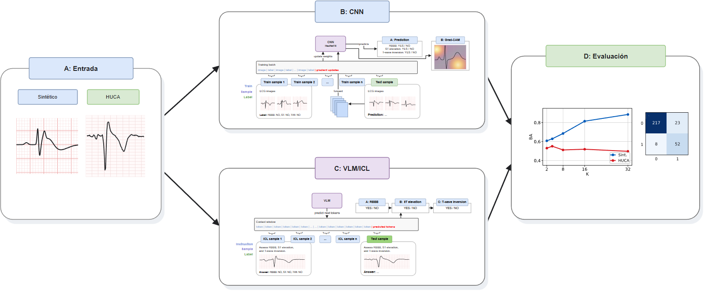
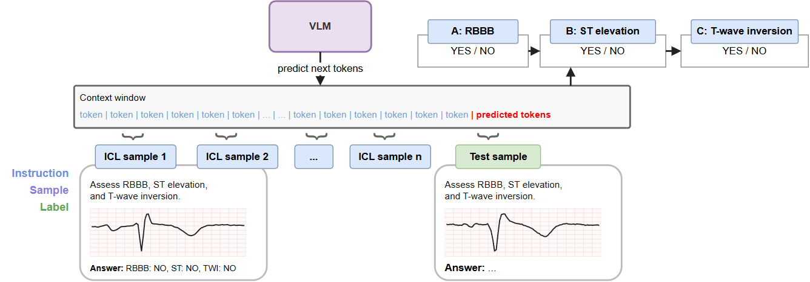
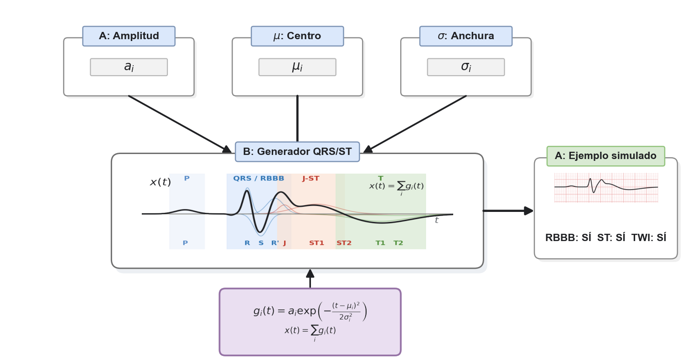

# ECG Few-Shot Learning

Companion code for the undergraduate thesis (TFG) **Análisis de ECGs con grandes modelos de lenguaje: aplicación a enfermedades raras** (*ECG analysis with large language models: application to rare diseases*).

Confirmed, labelled examples of a rare disease can be difficult to assemble. Few positive cases leave fewer variations of the ECG available for training and make it harder to assess which positive cases a classifier misses. This study examines whether **in-context learning (ICL)** can use a small set of labelled examples to guide ECG image classification, taking Brugada as the case study.

Gemma 4, an open-weight vision-language model, receives labelled ECG examples with the query while its weights remain fixed. **ResNet18 provides the supervised reference**: its weights are adjusted using training examples. The evaluation first uses the **QRS/ST simulator**, then real recordings from the Hospital Universitario Central de Asturias (HUCA), to examine the role of the number and source of examples. In the preserved clinical evaluation, Gemma performs best when its examples come from the clinical cohort. The results below also show the errors that remain.

This repository contains the code, presets, tests, and selected figures. Clinical records and patient-level outputs remain outside Git. These experiments require clinical validation before any use to support professional review.

[Results](#results) · [Run experiments](#run-experiments) · [Code map](#code-map) · [Protocols](docs/experiments.md) · [Figure provenance](docs/results.md)

## Experimental workflow

The models receive a **rendered tracing of a central beat of V1**, a right precordial lead. The clinical source is a numerical ECG recording from which that beat is extracted and rendered. The unit held out for evaluation is the patient, even though the input shows a single beat.



The diagram summarizes the procedure. Its embedded panels illustrate the workflow. The aggregate sources for reported results are documented separately.

**K is the number of labelled examples supplied for a fold**: demonstrations for Gemma or training examples for ResNet18. Each test fold holds out a whole patient. In the clinical comparison, ResNet18 also uses **eight additional labelled patients for validation**, four per class, to select the stopping point and decision threshold. Training, validation, and test patients are disjoint. Gemma uses K demonstrations without this additional validation set or weight updates.

| Experiment | Input and reference | Purpose |
| --- | --- | --- |
| Simulated morphology | Tracings from the QRS/ST simulator with explicit RBBB, ST-elevation, and T-wave-inversion annotations | Examine recognition under controlled morphology |
| Synthetic-to-real transfer | Synthetic training examples or demonstrations, evaluated on HUCA | Examine transfer to clinical recordings and optional domain adaptation |
| Clinical classification | Real V1 tracings and the dataset's binary clinical reference | Compare ICL with a supervised reference on the clinical task |

Right bundle branch block (RBBB), ST elevation, and T-wave inversion can coexist in simulated and real beats. The annotation differs: the simulator defines those findings, whereas the HUCA task uses a patient-level clinical reference. An unannotated clinical finding is not a negative finding.

### In-context learning

Gemma receives an instruction, labelled example images, and an unlabelled test image. The examples specify the requested label and give visual references for the current query without updating the model's weights. The experiments compare no examples (`zero_shot`), standard selection (`estandar`), and class-balanced selection (`balanced`).



The diagram depicts the morphological task, where the answer contains three findings. In the clinical experiment, the requested answer is the binary clinical reference. Both experiments use rendered ECG images as inputs.

### Supervised reference

ResNet18 is trained on the selected examples. The morphological CNN predicts three findings before applying the shared Brugada rule. The clinical CNN learns the binary reference directly. The additional clinical validation patients are used for model and threshold selection, so K alone does not describe the CNN's total labelled-data use.


Grad-CAM is available for inspecting CNN outputs locally. Such maps provide qualitative explanations of a selected output and do not establish clinical validity.

### QRS/ST simulator

The simulator combines Gaussian components and varies their morphology before rendering each beat. This creates controlled examples with explicit finding labels, allowing the study to distinguish recognition on simulated tracings from transfer to clinical recordings.



Editable [draw.io sources](docs/assets/diagrams/) accompany the diagrams.

## Results

The principal question is whether labelled examples can guide a fixed-weight model on the clinical task. With **32 balanced clinical examples**, Gemma obtained **76.12% balanced accuracy** in the preserved cohort. Its sensitivity was **74.14%** and its specificity **78.11%**: positive cases were still missed. In the clinical evaluation without examples, Gemma did not identify positive cases.


The figure shows the clinical result across example-set sizes. The table fixes **K = 32** for all methods and reports mean ± standard deviation across three seeds, rather than selecting a different best K for each method.

<!-- final-results-table -->
| Task | Method | Balanced accuracy (%) | F1 (%) |
| --- | --- | --- | --- |
| HUCA clinical reference | Gemma, balanced real examples | 76.12 ± 1.11 | 69.92 ± 1.33 |
| HUCA clinical reference | ResNet18 CNN, standard | 53.15 ± 0.24 | 46.86 ± 0.68 |
| HUCA clinical reference | ResNet18 CNN, balanced | 53.48 ± 0.28 | 47.38 ± 1.29 |
| Simulated morphology | Gemma, balanced examples | 90.42 ± 1.06 | 82.53 ± 1.16 |
| Simulated morphology | ResNet18 CNN | 88.54 ± 1.28 | 77.08 ± 2.26 |
<!-- /final-results-table -->

### Interpretation and transfer

Performance on the QRS/ST simulator does not establish transfer to real recordings. Both methods improve with more simulated examples, but the synthetic-to-HUCA experiments do not show a comparable clinical benefit. Synthetic findings and clinical references are different targets, so these experiments cannot isolate visual domain shift alone.

| CNN on simulated morphology | Gemma on simulated morphology |
| --- | --- |
|  |  |

A possible explanation for the stronger clinical ICL result is that HUCA demonstrations share the query's label definition and variation in the tracing. This interpretation is consistent with the weaker results without examples and with synthetic examples, but the comparison does not establish a causal explanation. For ResNet18, adjusting all layers with few cases introduces an overfitting risk. The observed performance alone does not prove that this is the cause of its errors.

The clinical CNN uses K training patients **plus eight validation patients**, while Gemma uses K labelled demonstrations. Variation across seeds repeats the same patients and does not measure population uncertainty. See [exact sources, conditions, and hashes](docs/results.md). No new experiments were run to create this summary.

### Scope and further work

The input is one rendered V1 beat, so it does not provide the rhythm, other leads, or full clinical assessment of a patient. The experiments do not establish performance on photographs or scans of ECG documents, external clinical generalization, or diagnostic validity. Public HUCA source labels also differ from the preserved final campaign. Rebuilding the public data creates a new provisional dataset.

The clinical result motivates further study of ICL for prioritizing professional review and collecting labelled cases, subject to clinical validation. Expanding the number and diversity of demonstrations is one research direction. Fine-tuning Gemma's weights would be a separate experiment with a different training and evaluation protocol.

## Run experiments

Run commands from the repository root with **Python 3.12+** and [uv](https://docs.astral.sh/uv/). The CLI works on Windows, Linux, and macOS.

### 1. Install and check the pipeline

```bash
git clone https://github.com/nahuelcostac/ecg-few.git
cd ecg-few
uv sync --locked
uv run ecg-few --help
uv run ecg-few build-synthetic --config configs/smoke_dataset.toml
uv run ecg-few vlm --config configs/smoke_vlm.toml
```

This offline smoke run generates five synthetic records and uses fixed mock predictions. It checks execution, not model performance. Data goes to `data/synthetic/smoke/` and provisional outputs go to `outputs/work/smoke_vlm/`.

### 2. Prepare data

```bash
uv run ecg-few build-synthetic --config configs/simulator.toml
uv run --extra real-data ecg-few build-huca
```

Before `build-huca`, obtain [Brugada-HUCA 1.0.0](https://physionet.org/content/brugada-huca/1.0.0/) and place its original records under `data/raw/brugada-huca/1.0.0/`. The builder does not download them. The public source labels differ from the preserved final campaign: rebuilding creates a provisional dataset. See [data preparation and provenance](docs/data.md).

### 3. Launch a campaign

Install CNN and clinical-data dependencies together:

```bash
uv sync --locked --extra cnn --extra real-data
```

| Campaign | Command |
| --- | --- |
| CNN on synthetic morphology | `uv run --no-sync ecg-few cnn --config configs/cnn_simulator.toml` |
| CNN trained on synthetic data, tested on HUCA | `uv run --no-sync ecg-few cnn --config configs/cnn_morphology.toml` |
| Clinical CNN on HUCA | `uv run --no-sync ecg-few cnn-clinical --config configs/cnn_clinical.toml` |
| VLM on synthetic morphology | `uv run --no-sync ecg-few vlm --config configs/vlm_simulator.toml --model MODEL_ID` |
| VLM on HUCA with synthetic context | `uv run --no-sync ecg-few vlm --config configs/vlm_morphology.toml --model MODEL_ID` |
| Clinical VLM with real context | `uv run --no-sync ecg-few vlm --config configs/vlm.toml --model MODEL_ID` |

For remote VLM inference, set `VLM_API_BASE` and, when required by the endpoint, `VLM_API_KEY` in your shell. `.env.example` lists supported variables. `.env` files are not loaded automatically. The endpoint receives the selected images.

For local inference, install `--extra vlm-local` alongside the other extras you need, then add `--vlm-runtime local_gpu`. Model access may require `HF_TOKEN`. Local execution permits evaluation within a controlled deployment. The remote option sends images to the configured endpoint. GPU setup is covered in [development](docs/development.md).

Every command has `--help`. CLI options override TOML presets. Use a distinct output root for a changed experiment, for example:

```bash
uv run --no-sync ecg-few cnn --config configs/cnn_simulator.toml --epochs 5 --output-root outputs/work/cnn_trial
```

New campaigns are **provisional**, write to `outputs/work/<campaign>/`, and record configuration and input/source hashes in `run_manifest.json`. Repeating a compatible command resumes it. The canonical results are protected from experiment writes. [Protocols and additional recipes](docs/experiments.md) cover domain adaptation, comparisons, and audits.

## Code map

```text
src/ecg_few/          Reusable experiment code and the ecg-few CLI
  datasets/          HUCA preparation and synthetic dataset export
  simulator/         Waveform generation, morphology, and rendering
  protocols/         Patient-level folds and support selection
  cnn/clinical/      Binary clinical training, folds, thresholds, Grad-CAM
  cnn/morphology/    Morphological models, training, adaptation, Grad-CAM
  vlm/               Context selection, inference backends, response handling
  prompts/           Packaged Markdown instructions and response schemas
  evaluation/        Metrics and campaign audits
  reporting/         Aggregate reports, comparisons, and plots
  experiment_io/     Storage, provenance, resume, output protection
configs/             Dataset, smoke, CNN, and VLM presets
scripts/run/         Optional POSIX shell launchers using the same CLI
tests/               Offline unit and integration tests with synthetic data
docs/                Protocols, code architecture, and supporting figures
  assets/diagrams/   draw.io sources and exported procedure images
  assets/results/    Selected aggregate result images
```

Reusable logic belongs in the package. Launchers only pass arguments to the CLI. The package distribution is named `ecg-vlm`, the import package is `ecg_few`, and the command is `ecg-few`. See [architecture](docs/architecture.md) for module boundaries.

For local checks:

```bash
uv run --no-sync ruff check .
uv run --no-sync ruff format --check .
uv run --no-sync pytest -q
```

The repository does not include GitHub Actions. See [development](docs/development.md) and [contributing](CONTRIBUTING.md) for local verification. No open-source license has been granted. See [LICENSE](LICENSE). Citation metadata is in [CITATION.cff](CITATION.cff).
