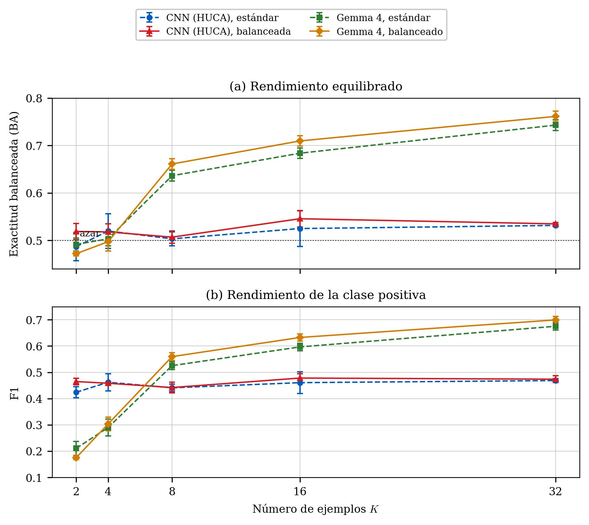

# ECG como imagen para Brugada con pocos ejemplos

Este repositorio contiene el código y la memoria de un estudio sobre clasificación de ECG representados como imagen. Se comparan dos usos de un conjunto pequeño de ejemplos:

- una CNN ResNet18 morfológica transferida desde el simulador y una variante que decide entre una etiqueta clínica positiva y negativa
- Gemma 4 E4B como modelo de visión y lenguaje con aprendizaje en contexto

El trabajo es experimental. No proporciona diagnóstico, no descarta enfermedad y no sustituye la revisión especializada.

## Diseño y datos

Los dos enfoques se evalúan por paciente con `K = 2, 4, 8, 16, 32` y las semillas `42, 123, 2026`. El VLM añade una condición zero-shot con `K = 0`.

| Conjunto | Pacientes | Imágenes únicas | Positivos | Negativos | Referencia |
|---|---:|---:|---:|---:|---|
| Simulador QRS/ST | 100 | 100 | 20 | 80 | Regla morfológica |
| Subconjunto HUCA procesado | 317 | 317 | 116 | 201 | `clinical_brugada` de la campaña |

Las matrices agregadas contienen 300 y 951 predicciones, respectivamente, porque suman tres semillas sobre los mismos pacientes. Esos valores no son tamaños de muestra ni números de imágenes únicas.

La CNN morfológica aprende RBBB, elevación ST e inversión de T en el simulador. La muestra clínica no contiene esas tres anotaciones por imagen, por lo que su evaluación real mide transferencia hacia una referencia clínica. La CNN clínica aprende directamente `clinical_brugada`. Gemma 4 se evalúa con contexto estándar, contexto balanceado y sin demostraciones.

La campaña `cnn_clinical_brugada_loocv` añade una ResNet18 binaria entrenada directamente con imágenes V1 del HUCA. Su promoción final es aditiva y conserva sin cambios el paquete original. La procedencia y el hash propio se registran en `outputs/final_results_tfg/CNN_CLINICAL_PROMOTION.json` y `outputs/final_results_tfg/SOURCE_CNN_CLINICAL.sha256`.

## Resultados finales

La única fuente canónica es [`outputs/final_results_tfg/`](outputs/final_results_tfg/README.md). Contiene el paquete `Final Results TFG`, importado el 30 de agosto de 2026, y la promoción aditiva de la CNN clínica, autorizada el 25 de octubre de 2026. No deben mezclarse estos resultados con campañas anteriores. `reports/loocv/` es su espejo agregado y versionado. Las tablas y figuras de esta página son derivados.

### Datos generados por el simulador

| Método | K | BA, media y DE | F1 | Sens. | Esp. |
|---|---:|---:|---:|---:|---:|
| CNN ResNet18 | 32 | 0.885 ± 0.013 | 0.771 | 0.867 | 0.904 |
| Gemma 4 zero-shot | 0 | 0.500 ± 0.000 | 0.000 | 0.000 | 1.000 |
| Gemma 4 ICL estándar | 32 | 0.879 ± 0.008 | 0.781 | 0.833 | 0.925 |
| Gemma 4 ICL balanceado | 32 | 0.904 ± 0.011 | 0.825 | 0.867 | 0.942 |


### Transferencia entre el simulador y los ECG clínicos

La CNN base alcanza su mejor punto real en `K=4`, con BA `0.551 ± 0.034`. MMD mejora la base de `K=32` desde `0.498` hasta `0.546`, pero no supera el mejor resultado global de la CNN.

Gemma 4 con demostraciones del simulador permanece cerca del azar. El mejor punto balanceado aparece en `K=16`, con BA `0.514 ± 0.008`, sensibilidad `0.063` y especificidad `0.965`.

### Aprendizaje clínico directo

| Método | K | BA, media y DE | F1 | Sens. | Esp. |
|---|---:|---:|---:|---:|---:|
| CNN clínica estándar | 32 | 0.532 ± 0.002 | 0.469 | 0.580 | 0.483 |
| CNN clínica balanceada | 16 | 0.546 ± 0.017 | 0.478 | 0.580 | 0.511 |
| Gemma 4 zero-shot | 0 | 0.499 ± 0.001 | 0.000 | 0.000 | 0.998 |
| Gemma 4 ICL estándar | 32 | 0.743 ± 0.011 | 0.675 | 0.690 | 0.796 |
| Gemma 4 ICL balanceado | 32 | 0.761 ± 0.011 | 0.699 | 0.741 | 0.781 |



La CNN supera ligeramente al mejor ICL con `K=2` y `K=4`. Gemma 4 se distancia desde `K=8` y alcanza su máximo balanceado en `K=32`. La comparación es descriptiva: la CNN utiliza además ocho pacientes etiquetados de validación por pliegue y los modelos difieren en escala y preentrenamiento. El resultado no incluye validación externa ni pruebas inferenciales planificadas y no justifica un uso asistencial.

## Organización

```text
src/ecg_few/                    Código Python principal
scripts/eval/                   Evaluación y comparaciones
scripts/run/                    Entradas reproducibles
scripts/thesis/                 Figuras y auditoría de la memoria
prompts/                        Prompts VLM
reports/loocv/                  Resultados agregados para regenerar las gráficas
outputs/final_results_tfg/      Paquete final canónico (completo y local)
thesis/thesis/                  Fuente LaTeX
thesis/thesis/assets/results/   Figuras versionadas
```

El ZIP original y las salidas completas se conservan bajo `outputs/final_results_tfg/`, fuera de Git por tamaño y granularidad. `reports/loocv/` contiene el espejo versionado de sus informes agregados y es la ubicación que consumen los renderizadores del TFG. La relación entre ambas carpetas se documenta en `outputs/final_results_tfg/README.md` y `reports/loocv/README.md`.

La fuente LaTeX, los logos y todas las figuras utilizadas por la memoria también se versionan. Los datos clínicos del HUCA y las salidas LOOCV a nivel de paciente no son necesarios para compilar el PDF ni para regenerar sus gráficas; no deben exponerse ni utilizarse como fuente documental cuando existen agregados.

## Reproducción

Instalación:

```bash
uv sync --extra dev --extra cnn
```

Regeneración de las figuras finales con los resultados agregados incluidos en el repositorio:

```bash
RUN_COMPARISONS=0 sh scripts/run/build_tfg_report_figures.sh
```

Auditoría de cifras, unidades, figuras y uso de Draw.io:

```bash
uv run --no-sync python scripts/thesis/audit_final_tfg.py
```

### Compilación de la memoria

Tectonic descarga automáticamente los paquetes LaTeX requeridos y compila el proyecto con un motor compatible con XeTeX:

```bash
cd thesis/thesis
tectonic -X compile main.tex
```

Con una instalación completa de TeX Live también puede utilizarse XeLaTeX:

```bash
cd thesis/thesis
xelatex main.tex
xelatex main.tex
```

El resultado se genera en `thesis/thesis/main.pdf`. La plantilla usa Times New Roman cuando la fuente está instalada y recurre a TeX Gyre Termes en caso contrario.

Ejecuciones principales:

```bash
scripts/run/build_simulator_qrs_dataset.sh
scripts/run/build_brugada_huca_dataset.sh
scripts/run/run_cnn_simulator_qrs_loocv.sh
scripts/run/run_cnn_loocv.sh
scripts/run/run_cnn_clinical_loocv.sh
scripts/run/run_all_vlm_experiments.sh
```

Una nueva campaña de CNN clínica se ejecuta de forma provisional con:

```bash
scripts/run/run_cnn_clinical_loocv.sh
```

Las ejecuciones nuevas se escriben bajo `outputs/work/cnn_clinical_brugada_loocv/` y no sustituyen los resultados finales. Las figuras y tablas actuales se regeneran exclusivamente desde la fuente canónica con:

```bash
scripts/run/build_cnn_clinical_tfg_figures.sh
```

Validación del código:

```bash
uv run --no-sync pytest -q
uv run --no-sync ruff check src scripts tests
uv run --no-sync python -m compileall -q src scripts
```

## Limitaciones

La muestra clínica procede de un único centro y sus etiquetas no equivalen a los tres rasgos del simulador. La auditoría del 25 de octubre de 2026 confirma 93 etiquetas distintas entre los metadatos públicos y locales, y 66 entre los 317 pacientes evaluados. El CSV público contiene 287 valores 0, 69 valores 1 y siete valores 2. El CSV local contiene 201 negativos y 162 positivos. Al excluir 46 positivos con `basal_pattern=1`, se reproduce exactamente la selección final 116/201, pero no se dispone de la justificación clínica de los cambios de etiqueta. Las métricas miden las etiquetas locales, no exactitud diagnóstica verificada. No se han cambiado datos ni paquetes experimentales.

`thesis/AUDITORIA_PROCEDENCIA_HUCA.json` conserva recuentos y hashes, sin identificadores. La comprobación se reproduce con:

```bash
uv run --no-sync python scripts/thesis/audit_huca_provenance.py --check-public --output thesis/AUDITORIA_PROCEDENCIA_HUCA.json
```

La CNN clínica utiliza ocho pacientes de validación adicionales a los \(K\) de entrenamiento, mientras que el ICL solo usa \(K\) demostraciones. Las tres semillas repiten la evaluación sobre los mismos pacientes y su desviación estándar no representa incertidumbre poblacional.
